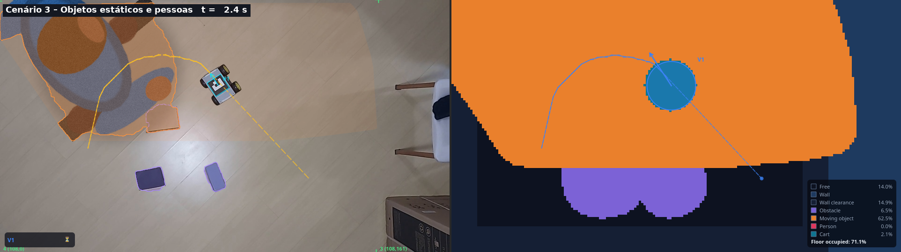

# Cart System: Vision-Guided Autonomous Cart Fleet

A PC application that runs a fleet of small autonomous carts on a factory-like floor. **One overhead camera** is the only sensor. The software finds every cart, obstacle and person in the image, plans collision-free routes, and drives each cart over Bluetooth in a closed loop. The carts are ESP32 robots running custom firmware.

The project also includes a **photo-realistic digital twin**. The production software runs unchanged on rendered camera images built from real recordings, so the whole stack can be tested at scale without hardware.


*Left: camera view with the cart's ArUco marker, detected obstacles, a person walking by, and the planned route. Right: the occupancy grid used by the planner (free / wall / obstacle / moving object / person / cart).*

---

## Highlights

- **Closed-loop visual control.** Camera frame → detection → grid → Theta* planning → motor commands → the cart moves → next frame. There are no encoders or onboard sensors.
- **Robust cart tracking.** ArUco markers with sub-pixel refinement and glare recovery. When a marker is lost, tracking falls back step by step: region-of-interest search, foreground blob, velocity prediction, then last known position.
- **Obstacle detection without training data.** Background subtraction against a median model of the empty floor. Each frame is aligned to that model with ORB + RANSAC, and the comparison is done in LAB colour space so shadows are ignored. Obstacles keep **object permanence**: a hidden obstacle is remembered.
- **People detection.** YOLO11-nano runs in a background thread, so the camera loop never blocks.
- **Any-angle path planning.** Theta* on a 192×108 occupancy grid with safety margins, look-ahead blocking checks, timed replanning, and yielding between carts.
- **Latency-aware motion control.** The video reaches the PC 100–200 ms late, so carts move in measured steps. Each cart's turn rate and speed are learned online.
- **Automatic per-cart calibration.** Marker heading offset, swapped or inverted motor wiring, and minimum start PWM (found by bisection).
- **Safety-first firmware.** On the ESP32, a FreeRTOS watchdog task stops the motors if no command arrives for 500 ms. Soft start limits current spikes that could brown out the board.
- **Digital twin for testing.** Virtual camera and Bluetooth drivers with the same interfaces as the real ones, simulated cart physics (latency, dead band, wheel gain errors), and simulated people walking around.

## Results

Scenario tests of the full production stack in the digital twin, 25 randomized routes per scenario. The engine only sees rendered camera images. The simulator's ground truth is used only for scoring.

| Scenario | Scene represented | Followed trajectory | No collisions | Route completed | Avg. route time |
|---|:-:|:-:|:-:|:-:|:-:|
| 1. Static objects | 25/25 | 25/25 | 25/25 | 24/25 | 41.4 s |
| 2. Static + moving object | 25/25 | 25/25 | 24/25 | 22/25 | 49.0 s |
| 3. Static objects + people | 24/25 | 25/25 | 23/25 | 24/25 | 52.3 s |
| 4. Fleet of 3 carts | 25/25 | 25/25 | 25/25 | 15/25 | 42.0 s |

Per-test data: [`results/scenario_tests/`](results/scenario_tests/). Column headers in those files are in Portuguese.

## Operation modes

At start-up you pick one of three modes:

| Mode | Camera | Carts | Use |
|---|---|---|---|
| **Simulation** | none | virtual, on a grid | Planning, routines and UI on a synthetic factory map |
| **Production** | real USB camera | real ESP32 carts over Bluetooth | The real system |
| **Virtual production** | rendered from real footage | simulated physics | Digital twin: the production stack, no hardware |

## Tech stack

| Area | Tools |
|---|---|
| Language | Python 3 (PC), C++/Arduino (firmware) |
| GUI | PyQt6 |
| Computer vision | OpenCV (ArUco, homography, background subtraction, ORB/RANSAC) |
| Deep learning | Ultralytics YOLO11n (COCO "person" class) |
| Numerics | NumPy |
| Communication | Bluetooth Classic SPP/RFCOMM with a simple text protocol |
| Embedded | ESP32 (WEMOS LOLIN32 Lite), FreeRTOS, 20 kHz LEDC PWM |

## Project structure

```
main.py               Entry point: mode selection and dark theme
config.py             Grid size, timing, colours
core/                 Domain model: grid, cart state machine, routines, scheduler
pathfinding/          Theta* any-angle planner with supercover line of sight
production/           Camera, calibration (homography), cart/obstacle/person
                      detection, Bluetooth controller, production engine
simulation/           Grid simulator, photo-realistic renderer, digital twin
ui/                   PyQt6 windows, canvases, panels and dialogs
tools/                Synthetic video generator, offline evaluation,
                      headless twin runs, scenario test suite
esp32-robot code/     Cart firmware (Arduino / ESP32)
data/                 Routines, calibration, floor background, twin templates
videos/               Real recordings the digital twin renders from
```

A full technical write-up of every component is in [`system_overview.txt`](system_overview.txt).

## Getting started

```bash
git clone git@github.com:AcyrM/Carrinho-Labirinto.git
cd Carrinho-Labirinto
python -m venv .venv && source .venv/bin/activate
pip install -r requirements.txt

python main.py          # choose Simulation or Virtual production to try it without hardware
```

`yolo11n.pt` downloads automatically on first use.

### Headless tools

```bash
# Closed-loop digital twin run with random missions (optionally recorded)
python tools/run_twin.py --minutes 2 --carts 3 --obstacles 6 --dynamic --record twin.mp4

# Scenario test suite (scenarios 1–4) and summary table
python tools/scenario_tests.py --scenario 1 --runs 25 --out results/scenario_tests
python tools/scenario_tests.py --summary results/scenario_tests

# Synthetic test videos with per-frame ground truth, then offline evaluation
python tools/synth_videos.py --out videos/synthetic
python tools/eval_videos.py videos/synthetic/*.mp4 --background "videos/Background 1.mp4"
```

## Hardware (production mode)

- Overhead USB camera looking down at the floor
- Each cart: ESP32 (WEMOS LOLIN32 Lite), 4 DC motors in a differential drive, H-bridge driver (MX1508 / DRV8833 / TB6612), battery pack, and a unique ArUco marker (`DICT_4X4_50`) on top
- Flash `esp32-robot code/cart_firmware/cart_firmware.ino` with the Arduino IDE (ESP32 board package)

Bluetooth protocol (one command per line):

```
PC → cart:  DRIVE:<left>:<right>   (-255..255)
            RAW:<left>:<right>     (exact PWM, used in calibration)
            STOP | PING
cart → PC:  HB:<uptime>:<reset reason>:<stalls>:<longest stall>   (every 2 s)
            PONG
```
